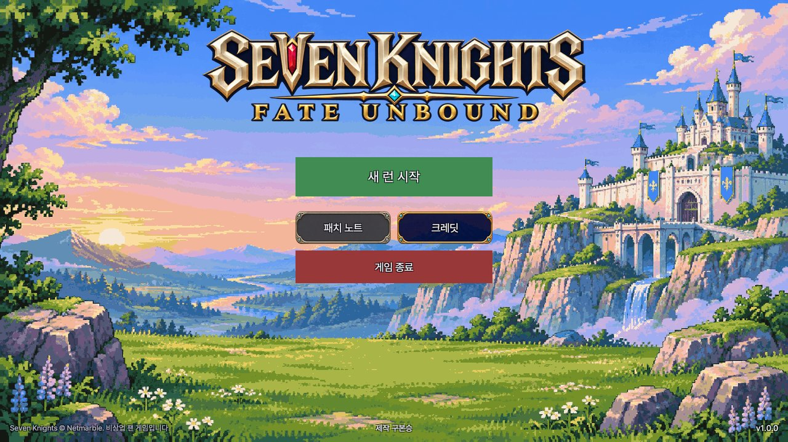
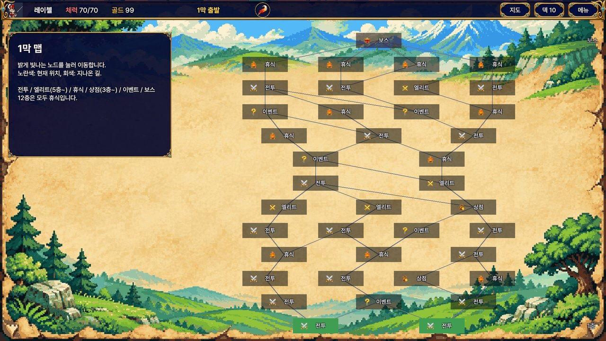
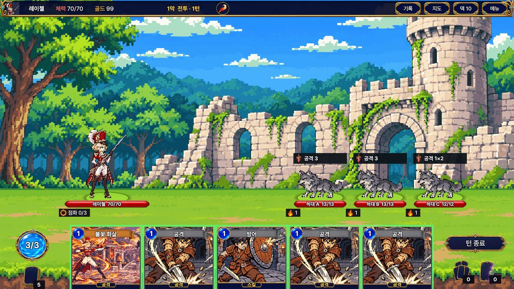
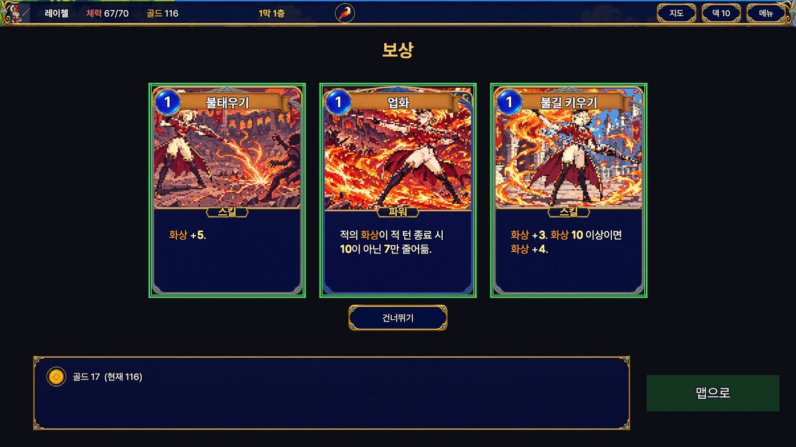

# 세븐나이츠: 페이트 언바운드

세븐나이츠 영웅으로 즐기는 로그라이크 덱빌딩 게임입니다. (Windows, 비상업 팬 게임)

## 게임 소개

- **영웅 7명**: 루디, 제이브, 델론즈, 스파이크, 레이첼, 아일린, 크리스. 영웅마다 고유 카드와 시작 장비, 전투 방식(보호막, 반격, 처형, 빙결, 화상, 감전, 저주)이 다릅니다.
- **2막 구성의 런**: 맵에서 길을 골라 전투·엘리트·휴식·상점·이벤트를 지나 보스를 쓰러뜨립니다. 카드를 모아 덱을 키우고, 장비로 전략을 바꿉니다.
- **회귀 단계 0~10**: 클리어할 때마다 그 영웅의 더 어려운 단계가 열립니다.
- **영웅 숙련**: 클리어로 얻은 정수로 시작 덱·장비·효과를 조절합니다.
- **이어하기**: 노드마다 저장되어, 껐다 켜도 이어서 할 수 있습니다.

| 맵 | 전투 | 보상 |
|---|---|---|
|  |  |  |

## 내려받기

[Releases](../../releases)에서 최신 버전을 받으세요.

- `FateUnbound_Setup_<버전>.exe` — 설치 파일
- `FateUnbound_<버전>_Portable.zip` — 설치 없이 압축만 풀어 실행

## 설치 방법

**설치 파일**
1. `FateUnbound_Setup_<버전>.exe`를 실행합니다. 관리자 권한은 필요 없습니다.
2. 기본 설치 위치는 `%LOCALAPPDATA%\Programs\FateUnbound`입니다.
3. 시작 메뉴의 「세븐나이츠: 페이트 언바운드」로 실행합니다.
4. 제거는 Windows 설정 → 앱에서 합니다. 저장 데이터는 남기며, 제거 마지막에 지울지 물어봅니다.

**휴대용 zip**
1. 원하는 폴더에 압축을 풉니다.
2. `FateUnbound` 폴더 안의 `FateUnbound.exe`를 실행합니다.

저장 위치: `%USERPROFILE%\AppData\LocalLow\Koo Bonseung\세븐나이츠_ 페이트 언바운드`
(설치 파일과 zip이 같은 위치를 써서, 새 버전으로 바꿔도 이어서 할 수 있습니다.)

## "Windows의 PC 보호" 경고가 뜰 때

코드 서명을 하지 않은 프로그램이라 처음 실행할 때 Windows SmartScreen 경고가 뜰 수 있습니다.

1. 경고 창에서 **추가 정보**를 누릅니다.
2. **실행**을 누릅니다.

## 최소 사양

- Windows 10 / 11 (64비트)
- 메모리 4GB, DirectX 11 그래픽, 저장 공간 500MB

## 고지

**Seven Knights © Netmarble. 비상업 팬 게임**입니다. 판매하지 않으며, 넷마블과 관계가 없습니다.
캐릭터 원화와 이름의 권리는 넷마블에 있습니다. 저작권 관련 문의를 받으면 배포를 내리겠습니다.

글꼴: Pretendard, Galmuri (SIL Open Font License 1.1)

제작: 구본승 · 문의: [Issues](../../issues)
